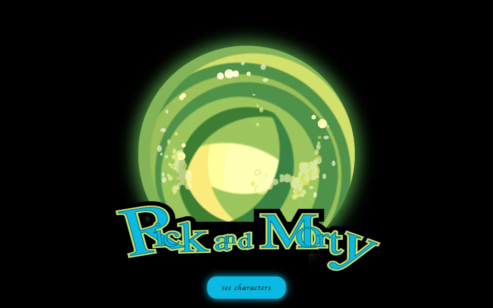
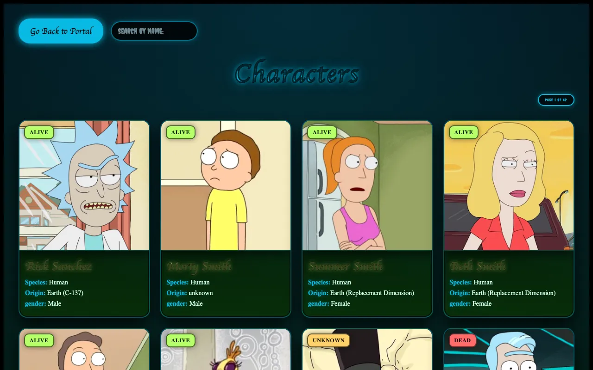
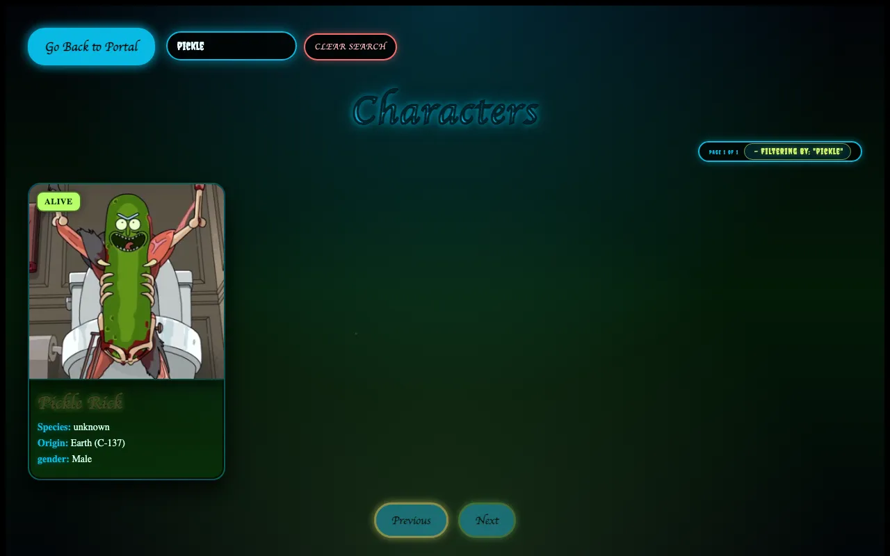
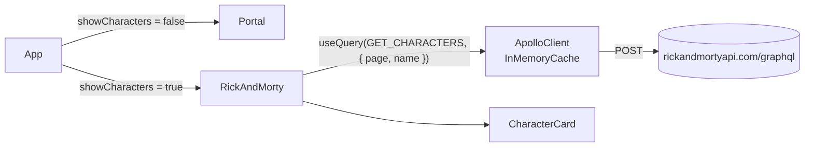

# Rick and Morty API Consumer

A React + TypeScript app that reads the public Rick and Morty GraphQL API with Apollo Client: an animated portal landing screen, then a paginated character grid with search by name.







## Features

- Portal landing screen made with CSS only (animated portal, bubbles and layered title). "See Characters" switches to the grid.
- Character cards with image, status badge (`alive`, `dead`, `unknown` each with its own color), species, origin and gender.
- Pagination with Previous / Next, disabled when the API returns no `prev` / `next` page. A badge shows "Page X of Y".
- Search by name: each keystroke resets to page 1 and refetches with the `name` filter. "Clear Search" resets it.
- Loading, error and empty states. An empty search result shows `public/nothing.png` and "Nothing was left".

## How it works



- `src/main.tsx` wraps the app in `ApolloProvider` with the client from `components/rickandmorty/graphql.ts` (`HttpLink` + `InMemoryCache`).
- `src/App.tsx` holds a single `showCharacters` boolean; there is no router.
- `RicksAndMortyCharacters.tsx` owns `page` and `searchTerm`, runs the query and renders the top bar, page badge and pagination.
- `CharacterCard.tsx` renders the grid (at most 20 cards, the API page size) and the loading / empty / error states.

### GraphQL query

`src/components/rickandmorty/graphQuery.ts`:

```graphql
query GetCharacter($page: Int!, $name: String) {
  characters(page: $page, filter: { name: $name }) {
    info { count pages next prev }
    results {
      id name status species image gender
      origin { name }
      location { name }
    }
  }
}
```

`name` is sent as `null` when the search box is empty, which returns all characters. The API is public and needs no key. You can try the same query in the API's playground at https://rickandmortyapi.com/graphql.

## Stack

React 19, TypeScript 5.9, Vite 7, Apollo Client 4, graphql 16, plain CSS. Fonts: Creepster (Google Fonts) and a "Get Schwifty" webfont loaded from a CodePen CDN URL in the CSS.

## Running locally

Prerequisite: Node.js 20.19+ (required by Vite 7). Internet access is needed for the API and the fonts.

```bash
npm install
npm run dev       # http://localhost:5173
npm run build     # tsc -b + vite build, output in dist/
npm run preview   # serves the build
npm run lint
```

The build is static and can be hosted on any static host (Vercel, Netlify, GitHub Pages).

## Project structure

```
src/
├── main.tsx                      # ApolloProvider + root
├── App.tsx                       # portal <-> characters toggle
└── components/
    ├── CharacterCard.tsx         # grid + loading/empty/error states
    └── rickandmorty/
        ├── graphql.ts            # ApolloClient
        ├── graphQuery.ts         # GET_CHARACTERS
        ├── RicksAndMortyCharacters.tsx
        ├── characters.css
        └── portal/
            ├── portal.tsx
            ├── fullscene.css
            └── style.css
public/                           # favicon (Rick.png), nothing.png and character art
```

## Ideas for next steps

- Locations and episodes pages (the API has `locations` and `episodes` queries with filters).
- Debounce the search input; today every keystroke fires a request.
- Component tests with Apollo's `MockedProvider` (there are no tests yet).

## Credits

Data and character images: [The Rick and Morty API](https://rickandmortyapi.com). Rick and Morty is a trademark of its owners; this is a non-commercial study project.
